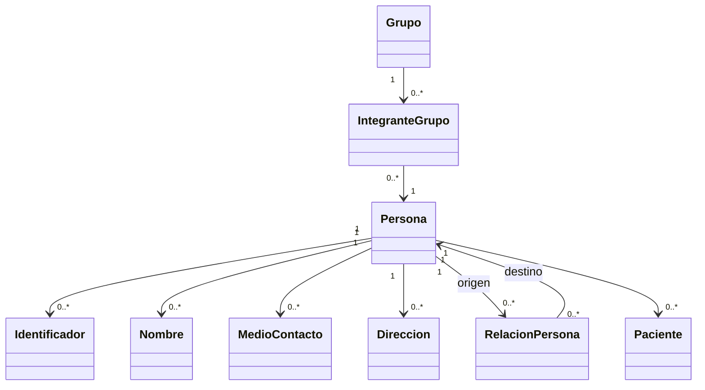

# APS — Documento de Arquitectura 001: Admisión

**Estado:** Borrador de arquitectura para revisión  
**Versión:** 0.1.0  
**Fecha:** 2026-10-27  
**Alcance:** Módulo Admisión, reutilizable en APS, Teletón, clínicas y otros ámbitos asistenciales.

## 1. Propósito

Admisión permite identificar y registrar personas, gestionar sus identificadores y datos de contacto, representar sus relaciones y agrupaciones familiares, y vincularlas a una identidad de paciente cuando exista un contexto asistencial.

El diseño debe ser **independiente del modelo asistencial**. Los conceptos particulares de APS o Teletón no deben imponerse al núcleo común.

## 2. Principios acordados

1. **Primacía clínica:** los registros clínicos no son formularios REM; la reportabilidad se deriva de hechos clínicos y operacionales. Admisión no implementa REM.
2. **Lenguaje del dominio:** utilizar los nombres `Persona` y `Paciente`. No utilizar `PersonaNatural` ni introducir `PersonaJuridica` en este módulo.
3. **Modularidad:** no diseñar entidades de proveedores, programas, prestaciones, agenda ni otros módulos por anticipado.
4. **Identidad diferenciada:** `Persona` existe independientemente de ser `Paciente`.
5. **Interoperabilidad por diseño:** considerar FHIR internacional y los perfiles chilenos como referencias semánticas y de intercambio, sin copiar su estructura como modelo físico.
6. **Privacidad por diseño:** aplicar protección de datos, autorización, minimización y trazabilidad desde el núcleo.
7. **Diseño progresivo:** no convertir decisiones pendientes en reglas definitivas ni generar implementación sin validación.

## 3. Alcance funcional

### Incluido

- Registro, búsqueda y actualización de `Persona`.
- Identificadores múltiples (por ejemplo, RUT y pasaporte) con emisor, tipo y estado.
- Nombres y atributos demográficos pertinentes.
- Medios de contacto: teléfono, correo y otros medios admitidos por el dominio.
- Direcciones y vigencia.
- Relaciones entre personas: parentesco, cuidado, tutoría y representación, distinguiendo la relación declarada de cualquier autorización legal.
- Agrupaciones de personas: familia, hogar y otras agrupaciones configurables.
- Integrantes, roles dentro de la agrupación y períodos de pertenencia.
- Vinculación de `Persona` con `Paciente` en contexto asistencial.
- Controles de calidad, duplicidad, auditoría y acceso a datos.

**Ampliación explícita aprobada el 2026-10-27:** catálogo compartido **Administración > Centros de Salud**, con persistencia de centros y sectores para la institución del despliegue. Admisión consume este catálogo sin poseerlo ni duplicarlo. Incluye código interno único, DEIS opcional separado, nombre/descripción, comuna, dirección, teléfonos/correos múltiples, estado y configuración de sectores. No crea un mantenedor de instituciones ni implementa farmacia, bodega u otros módulos. La persistencia de Persona/Paciente continúa pendiente.

Referencia semántica verificada: CL Core publicado **1.9.3**, basado en **FHIR R4 4.0.1**, perfiles [CoreOrganizacionCl](https://hl7chile.cl/fhir/ig/clcore/StructureDefinition-CoreOrganizacionCl.html) y [CoreLocalizacionCl](https://hl7chile.cl/fhir/ig/clcore/StructureDefinition-CoreLocalizacionCl.html). La organización responsable y la sede física se distinguen en los adaptadores futuros; el modelo interno no reproduce recursos FHIR. Un sector administrativo no se convierte automáticamente en `Location.partOf`, ni el centro de adscripción en `Patient.managingOrganization` (custodio del registro). No se implementa exportación ni se afirma conformidad FHIR.

**Ajuste explícito del mantenedor:** formularios en modales con Toolbar superior, contactos consistentes con Admisión (colecciones de valor, uso y un principal) y sectores con ID generado, nombre, color y activo, pertenecientes a un centro. El color es presentación local, sin equivalencia FHIR inferida; el código funcional de sector del prototipo anterior se retira.

### Excluido

- Registro de atenciones, diagnósticos, evoluciones y tratamientos.
- Formularios clínicos dinámicos y componentes clínicos inteligentes (se definirán aparte).
- Programas, actividades, prestaciones y estadísticas REM.
- Agenda, facturación, proveedores y gestión institucional general.
- Diseño de un repositorio maestro compartido entre instituciones, hasta resolver su gobernanza.

## 4. Glosario del dominio

| Concepto | Definición inicial |
|---|---|
| Persona | Individuo identificable registrado en la plataforma, sea o no paciente. |
| Paciente | Vinculación de una Persona con un contexto asistencial. No sustituye su identidad de Persona. |
| Identificador | Valor emitido por una autoridad o sistema, con tipo y ámbito de unicidad. |
| Medio de contacto | Canal por el cual puede contactarse a una Persona, con uso, prioridad y vigencia cuando corresponda. |
| Dirección | Localización física o postal asociada a una Persona, con uso y vigencia. |
| Relación personal | Vínculo entre dos Personas, potencialmente dirigido, tipificado y temporal. |
| Grupo | Agrupación de Personas con tipo, reglas y propósito determinados. |
| Integrante | Participación de una Persona en un Grupo, con rol y vigencia. |

**Nota:** hogar, familia, tutoría y contacto de emergencia no son sinónimos. Una persona puede tener múltiples relaciones y pertenecer a varias agrupaciones según las reglas del dominio.

## 5. Modelo conceptual preliminar

**Advertencia:** este diagrama es conceptual; no fija tablas, claves físicas, microservicios ni cardinalidades institucionales definitivas. La cardinalidad Persona→Paciente representa la posibilidad de registros asistenciales por contexto, pendiente de decisión de identidad entre instituciones.

## 6. Reglas funcionales iniciales

- Cada Persona tendrá una identidad técnica estable que no dependa del RUT ni de otro identificador externo.
- Una Persona podrá existir sin ser Paciente y sin pertenecer a un grupo.
- Los identificadores tendrán tipo, autoridad emisora y ámbito; no asumir que todos son globalmente únicos.
- Los medios de contacto podrán ser múltiples; prioridad y vigencia no equivalen a consentimiento para recibir comunicaciones.
- Las relaciones personales se modelarán independientemente de la pertenencia a grupos.
- Tutoría, parentesco, convivencia y autorización de acceso a datos clínicos deben distinguirse.
- Los grupos deberán admitir tipos y reglas propias del contexto, sin codificar APS o Teletón en la entidad común.
- Las operaciones de fusión o resolución de duplicados requerirán procedimiento controlado, registro de auditoría y preservación de referencias.
- No eliminar automáticamente historiales clínicos por cambios de identidad, rectificaciones o solicitudes de supresión.

## 7. Referencia de interoperabilidad

FHIR se utiliza como **referencia**, no como base de datos interna. Verificar las versiones y perfiles vigentes en cada integración concreta.

| Concepto | Referencia FHIR | Precaución |
|---|---|---|
| Persona | Person / Patient según escenario | `Person` de FHIR no equivale necesariamente a la entidad interna. |
| Paciente | Patient | Su alcance y sus identificadores dependen del perfil de intercambio. |
| Identificador | Identifier | Tipo de dato, no recurso independiente. |
| Nombre | HumanName | Tipo de dato. |
| Contacto | ContactPoint | Tipo de dato; considerar uso, prioridad y período. |
| Dirección | Address | Tipo de dato. |
| Persona relacionada con paciente | RelatedPerson / Patient.contact | No representan por sí solos un árbol familiar completo. |
| Agrupación | Group | Evaluar limitaciones semánticas para hogar y familia. |

Referencias para análisis:
- FHIR R5: https://hl7.org/fhir/R5/
- FHIR R4: https://hl7.org/fhir/R4/
- HL7 Chile: https://hl7chile.cl/
- Guías de implementación MINSAL: verificar edición, estado y URL canónica antes de mapear.

**Regla:** no mezclar recursos, elementos y cardinalidades de diferentes versiones sin un mapeo explícito y probado.

## 8. Protección de datos y seguridad

Referencias normativas que deben validarse con asesoría jurídica y versiones vigentes:
- Ley 19.628, modificada por Ley 21.719 (vigencia general desde 2026-12-01).
- Ley 20.584, en cuanto a derechos de pacientes y confidencialidad de ficha clínica.
- Ley 21.668, en cuanto a interoperabilidad de fichas clínicas.

Requisitos de arquitectura:
- Minimización de datos y propósito del tratamiento documentado.
- Control de acceso por identidad, rol, operación y contexto; aplicar menor privilegio.
- Auditoría de consulta, modificación, exportación y acceso excepcional a datos sensibles, con controles para proteger los propios logs.
- Diferenciar base legal del tratamiento, consentimiento cuando corresponda y preferencias de contacto.
- Cifrado en tránsito y en reposo, gestión de secretos y prevención de exposición en logs.
- Políticas de retención, rectificación y supresión condicionadas a obligaciones legales de conservación.
- Evitar acceso transversal entre instituciones sin una base jurídica y una política explícita.
- Evaluar riesgos de tratamiento y protección de datos antes de incorporar IA a datos identificables.

## 9. Decisiones abiertas

| ID | Pregunta | Estado |
|---|---|---|
| ADR-ADM-001 | ¿Identidad de Persona global o separada por institución con vinculación? | Pendiente |
| ADR-ADM-002 | ¿Qué tipos de grupos y roles se admiten inicialmente? | Pendiente |
| ADR-ADM-003 | ¿Qué atributos demográficos son obligatorios, opcionales o condicionados? | Pendiente |
| ADR-ADM-004 | ¿Qué terminologías y perfiles FHIR Chile serán obligatorios por integración? | Pendiente |
| ADR-ADM-005 | ¿Cómo se acreditan tutoría, representación y permisos efectivos? | Pendiente |
| ADR-ADM-006 | ¿Qué política de resolución de duplicados y fusión se adoptará? | Pendiente |

## 10. Criterios de aceptación del diseño

- Persona y Paciente tienen responsabilidades claramente separadas.
- Se pueden representar contactos y direcciones múltiples.
- Se pueden representar relaciones personales sin requerir pertenencia a un hogar.
- Se pueden representar grupos familiares y sus integrantes con vigencia.
- El modelo no presupone que todos los integrantes son pacientes.
- Existe trazabilidad de cambios y controles de acceso definidos.
- Las correspondencias FHIR están documentadas sin acoplar el dominio al estándar.
- No se incorporan entidades de módulos futuros.

## 11. Próximo paso autorizado

Revisar y validar el alcance y las decisiones abiertas de Admisión. **Este documento no autoriza por sí solo crear tablas, endpoints ni código de producción.**
