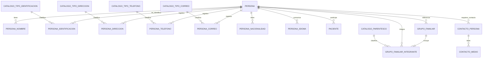

# Admisión — Estructura funcional de datos

**Versión:** 0.1.0 (propuesta para revisión)  
**Fecha:** 2026-10-27  
**Estado:** Modelo conceptual/funcional; no es esquema TypeORM ni migración aprobada.

Este documento convierte en estructuras visibles las decisiones registradas en [ADMISION_REQUISITOS_FUNCIONALES.md](./ADMISION_REQUISITOS_FUNCIONALES.md). Define entidades, atributos funcionales, cardinalidades y relaciones. No fija todavía tipos SQL, estrategia física multiinstitución, endpoints ni implementación.

La arquitectura técnica acordada es PostgreSQL, TypeORM, NestJS y arquitectura hexagonal en `api/`; Angular 19 y PrimeNG 19 en `app/`. El modelo SQL Server de [ADMISION_MODELO_DATOS.md](./ADMISION_MODELO_DATOS.md) es un borrador de referencia, no la persistencia objetivo.

**Convención técnica confirmada:** todas las tablas del sistema usarán una PK técnica `INT` autoincremental; las FK tendrán el mismo tipo. RUT y ficha no son PK. Esta convención no aprueba por sí sola el resto de contratos de persistencia pendientes de Admisión.

## 1. Vista general

`Institución` es el contexto propietario de los registros. Su entidad/clave física y si se representa por una tabla, una base o configuración de despliegue están pendientes; no se crea aquí una tabla institucional por inferencia.

## 2. Entidades principales

### 2.1 `Persona`

Identidad de un individuo dentro del contexto institucional. Puede existir sin `Paciente`, dirección, teléfono o correo.

En **Admisión > Ingresos**, el alta de la persona atendida crea también su `Paciente` en una única transacción. La separación conceptual y física se mantiene; la posibilidad de Persona sin Paciente corresponde a otros flujos, como familiares/contactos. En esta etapa solo se habilita el diseño del formulario, sin persistencia.

| Atributo funcional | Cardinalidad | Regla |
|---|---:|---|
| Identificador técnico interno | 1 | Estable; no es RUT, ficha ni otro identificador externo. |
| Estado de identidad | 1 | Identificada o provisional/desconocida. Una Persona provisional de urgencia no requiere nombre ni identificación confirmados. |
| Nombres | 0..* | Al menos un nombre oficial para una Persona identificada; admite un nombre único o un nombre y un apellido. Nombre preferido/social opcional. Conservar el anterior al cambiarlo. |
| Fecha de nacimiento | 0..1 | Opcional; solo fecha completa cuando se informa. |
| Fecha de defunción | 0..1 | Opcional; no elimina Persona, Paciente ni datos asistenciales relacionados. |
| Sexo biológico | 0..1 | Opcional; distinto de sexo registral, género e identidad de género. Catálogo y finalidad pendientes. |
| Sexo registral | 0..1 | Concepto disponible en CL Core 2.0 continuous build; inclusión en el catálogo funcional de APS pendiente de confirmación. |
| Identidad de género | 0..1 | Opcional; separada de sexo biológico y dato administrativo `Patient.gender`. Catálogo, finalidad y acceso pendientes. |
| Género administrativo interoperable | 0..1 | Opcional; semántica interna y catálogo pendientes. No se equipara automáticamente con sexo biológico, sexo registral o identidad de género. |
| País de nacimiento | 0..1 | Opcional; distinto de nacionalidad. Catálogo interno pendiente. |
| Estado civil | 0..1 | Opcional; catálogo interno y finalidad pendientes. |
| Identificaciones | 0..* | Ver entidad `PersonaIdentificacion`. |
| Direcciones | 0..* | Ver entidad `PersonaDireccion`. |
| Teléfonos | 0..* | Ver entidad `PersonaTelefono`. |
| Correos | 0..* | Ver entidad `PersonaCorreo`. |
| Nacionalidades | 0..* | Opcionales y repetibles; no inferir desde país de nacimiento ni situación migratoria. |
| Idiomas preferidos de comunicación | 0..* | Opcionales y repetibles; distintos de consentimiento y preferencias de contacto. |

Pueblo originario y situación migratoria quedan fuera del conjunto inicial hasta contar con finalidad aprobada y requisito verificado.

### 2.2 `PersonaNombre`

Colección de nombres para no imponer el modelo chileno de dos nombres y dos apellidos.

| Atributo | Cardinalidad | Regla |
|---|---:|---|
| Persona | 1 | FK obligatoria a `Persona`. |
| Uso del nombre | 1 | Catálogo interno pendiente: al menos nombre oficial y preferido/social. |
| Texto completo | 0..1 | Forma de visualización/intercambio cuando sea proporcionada. |
| Componentes del nombre | 0..* | Componentes ordenados; no asumir cantidad fija de nombres o apellidos. |
| Vigencia | 0..1 período | Conservar nombres anteriores y su período cuando corresponda. |
| Principal/vigente | 1 indicador de estado | Debe poder determinarse cuál es el nombre oficial vigente; regla técnica de unicidad pendiente. |

Correspondencia semántica orientativa: FHIR `HumanName`. La estructura física no tiene que reproducir literalmente ese tipo.

### 2.3 `PersonaIdentificacion`

| Atributo | Cardinalidad | Regla |
|---|---:|---|
| Persona | 1 | FK obligatoria a `Persona`. |
| Tipo de identificación | 1 | FK al catálogo interno. Tipos iniciales acordados: RUT/RUN chileno, pasaporte, documento nacional extranjero, identificador de salud/institución, provisorio/temporal y otro documento oficial. |
| Valor | 1 | Conservar caracteres significativos; normalización y validación específicas por tipo pendientes. |
| País emisor | 0..1 | Referencia a catálogo interno pendiente. |
| Período/estado de vigencia | 0..1 | Fechas y reglas según tipo pendientes. |
| Principal | 1 indicador | Entre las identificaciones de una Persona, exactamente una es principal si existe al menos una; si tiene RUT, el RUT es el principal. |
| Verificación y fecha | 0..1 | Estado y evidencia/proceso de verificación pendientes. |

**Unicidad:** RUT es identificador clave y no debe duplicarse dentro del alcance institucional. La clave técnica sigue siendo interna. La unicidad de identificadores extranjeros/provisorios y el alcance de unicidad del RUT entre instituciones requieren especificación antes de restricciones definitivas.

El número de ficha no pertenece a esta entidad: identifica al `Paciente` y es único en toda la plataforma, compartido entre centros.

### 2.4 `Paciente`

Participación asistencial de una Persona dentro de una institución.

| Atributo | Cardinalidad | Regla |
|---|---:|---|
| ID de Paciente | 1 | PK técnica INT autoincremental, estable e independiente de la modalidad de ficha. |
| Persona | 1 | FK obligatoria. Máximo un `Paciente` por Persona en cada institución. |
| Contexto institucional | 1 | Obligatorio conceptualmente; referencia física/tenant pendiente de decisión. |
| Centro de salud | 1 | Pertenencia a un solo centro, no varios simultáneos. Referencia al catálogo compartido de Administración; no inferir por domicilio. En el formulario visual se ofrece No informado sin inventar un establecimiento. Persistencia de Paciente pendiente. |
| Sector del centro | 0..1 | Un único sector activo del centro seleccionado, cuando ese centro utiliza sectores. Opcional con No informado, según aprobación; al cambiar de centro se limpia el sector. Reglas de cambio/historial persistente pendientes. |
| Número de ficha | 1 | Número entero, separado de la PK, único en toda la plataforma y compartido entre centros. Al crear Paciente, «Utiliza ficha propia» desactivado asigna el ID; activado asigna MAX(numeroFicha) + 1. Puede actualizarse para migraciones sin cambiar el ID técnico. No es el RUT. |
| Estado | 1 | Catálogo interno pendiente. |
| Fecha de registro/actualización | 1 / 0..1 | Fechas técnicas; formato y política temporal se definirán en el diseño backend. |

No existe una sola marca `principal` que compita entre RUT y número de ficha: la principalidad del RUT se aplica a identificaciones de `Persona`; la ficha identifica al `Paciente` con unicidad en toda la plataforma. Esta unicidad no autoriza compartir datos ni acceso entre instituciones.

**Decisión confirmada el 2026-10-27:** el tab 1 aporta los datos de Persona y el tab 2 los propios de Paciente, incluidos centro de salud y sector cuando corresponda. En el ingreso se crearán Persona y Paciente en una única transacción; no se crea ni persiste al cambiar de pestaña. La ficha global sustituye la definición previa de ficha única por institución, sin decidir por sí sola la identidad interinstitucional de Persona.

#### Configuración inicial de ficha — decisión confirmada

- Ubicación prevista: **Administración > Configuración**, ToggleSwitch **Utiliza ficha propia**, de alcance global para toda la plataforma.
- Desactivado (`false`): al crear un Paciente, Número de Ficha = ID de Paciente.
- Activado (`true`): al crear un Paciente, Número de Ficha = MAX(numeroFicha) + 1 sobre las fichas existentes de toda la plataforma. No se usa una secuencia independiente ni un próximo número configurable.
- El toggle controla exclusivamente la asignación en nuevas altas. Puede cambiarse aunque existan pacientes y no modifica las fichas ya registradas.
- Número de Ficha es de solo lectura en Admisión: no se captura ni modifica en altas o ediciones de ese proceso. La API de Admisión no debe aceptar una ficha proporcionada por el cliente; el servidor la asigna según la configuración. Las actualizaciones por migración son operaciones separadas y autorizadas.
- Se permite actualizar numeroFicha para migraciones, por ejemplo mediante correspondencias por RUT previamente validadas, manteniendo el ID técnico y las referencias. No confundir actualización de ficha con fusión de pacientes ni con autorización de acceso.
- También se contempla una migración desde cero tras una limpieza explícitamente autorizada de datos de ejemplo. Esta posibilidad no autoriza borrados automáticos ni cascadas sobre registros clínicos; su alcance y dependencias deben revisarse antes de ejecutar.
- El cálculo y la asignación de MAX(numeroFicha) + 1 deben ser atómicos ante altas concurrentes y preservar la unicidad global. Tras actualizar o importar fichas, el cálculo utiliza los valores resultantes sin reajustar una secuencia separada.
- Esta decisión sustituye el bloqueo de modalidad tras el primer paciente y la propuesta de secuencia configurable. Las actualizaciones de ficha deben preservar trazabilidad y no renumerar otros registros silenciosamente.

**Pendiente antes de persistir:** valor inicial cuando no hay fichas (MAX vacío); rango numérico y tipo SQL; mecanismo de exclusión concurrente para cálculo/asignación; resolución de colisiones cuando el ID coincide con una ficha existente en modo false; reglas de migración para fichas duplicadas o no numéricas y correspondencias ambiguas por RUT; política de reutilización de números históricos; permisos y auditoría de configuración/migración; vigencia/historial de cambios de centro/sector y significado/obligatoriedad del sector. La pertenencia simultánea queda limitada a un centro y un sector de ese centro cuando corresponda. Esta definición no implementa todavía configuración, tablas, actualizaciones ni limpieza de datos.

#### Catálogo compartido de centros y sectores

El catálogo de centros se implementa fuera del agregado Persona/Paciente, en Administración:

| Entidad | Contrato implementado |
|---|---|
| Centro de Salud | PK INT autoincremental; código interno único normalizado a mayúsculas; nombre/descripción; DEIS opcional separado; código oficial de comuna o vacío para No informado; dirección; listas de teléfonos y correos; activo; utilizaSectores. Tabla `Administracion.centros_salud`. |
| Sector | PK INT autoincremental de solo lectura; centroId INT con FK RESTRICT; nombre, color hexadecimal `#RRGGBB` y activo. Sin código funcional. Tabla `Administracion.sectores`. Sin traslado de sector entre centros ni borrado físico por API. |

Los teléfonos y correos del centro se almacenan en sendas colecciones JSONB de `{ valor, uso, principal }`. `uso` es el código de ContactPoint.use o vacío para No informado; cada colección con registros tiene exactamente un principal. El principal es preferencia de contacto y no autorización. En Administración se muestran con resumen principal y tabla modal, como en Admisión. Cambios aún no guardados pertenecen al formulario local.

Los sectores también se preparan localmente desde el formulario del centro, incluso antes de su alta, mediante resumen y tabla modal editable. El guardado del centro admite sectores nuevos sin ID y existentes con ID, y persiste el conjunto atómicamente. No acepta `centroId` desde el cuerpo ni sectores de otro centro. Omitir registros no los elimina; la desactivación preserva referencias.

Centro activo y utilizaSectores habilitado permiten agregar sectores. Desactivar un centro o la sectorización conserva sus registros. Admisión ofrece solo centros y sectores activos y no permite mezclar sectores de otro centro. No hay filas ficticias de centros/sectores para representar No informado: la ausencia de selección es `null`. Esto no persiste todavía la adscripción del Paciente.

### 2.5 `PersonaDireccion`

| Atributo | Cardinalidad | Regla |
|---|---:|---|
| Persona | 1 | FK obligatoria. |
| Tipo/uso | 1 | Catálogo interno pendiente. |
| País | 0..1 | Catálogo interno pendiente; admite direcciones internacionales. |
| Componentes territoriales | 0..* | Para Chile, permitir país/región/provincia/comuna estructurados; catálogos y jerarquía pendientes. |
| Componentes de dirección | 0..* | Líneas y componentes disponibles (calle, número, unidad, etc.); pueden faltar si se desconocen o no aplican. |
| Código postal | 0..1 | Opcional. |
| Período de vigencia | 0..1 | Conservar historial y vigencias. |
| Principal | 1 indicador | Exactamente una dirección vigente principal cuando hay al menos una dirección vigente. Persona puede no tener direcciones. |
| Verificación | Pendiente | No se ha definido qué significa verificar una dirección ni el proceso. |

Correspondencia orientativa: FHIR `Address`. `Address.use` no equivale a principal; el mapeo de principal requiere convención explícita.

### 2.6 `PersonaTelefono` y `PersonaCorreo`

Ambos son opcionales y repetibles; cada uno tiene un tipo/uso interno, estado de vigencia, principalidad e información individual de verificación.

| Atributo | `PersonaTelefono` | `PersonaCorreo` |
|---|---|---|
| Persona | FK obligatoria | FK obligatoria |
| Valor | Número | Dirección de correo |
| Tipo/uso | Obligatorio; catálogo interno pendiente | Obligatorio; catálogo interno pendiente |
| Código de país | Conservar para teléfonos internacionales | No aplica |
| Vigencia | Período/estado por definir | Período/estado por definir |
| Principal | Exactamente uno entre los vigentes si existe alguno | Exactamente uno entre los vigentes si existe alguno |
| Verificación | Estado y fecha individuales | Estado y fecha individuales |

El cambio de principal conserva el historial. No se asume que principalidad o verificación sean consentimiento para contactar. Formato canónico y proceso de verificación están pendientes. Correspondencia orientativa: FHIR `ContactPoint`; `rank` puede mapear preferencia según convención aprobada.

### 2.7 `GrupoFamiliar` y `GrupoFamiliarIntegrante`

| Entidad/atributo | Cardinalidad | Regla |
|---|---:|---|
| `GrupoFamiliar.PersonaReferencia` | 1 | Persona cuya admisión se está gestionando; FK obligatoria. |
| `GrupoFamiliar.Tipo` | 1 | Catálogo interno pendiente. Familia, hogar y convivencia no se asumen equivalentes. |
| `GrupoFamiliarIntegrante.GrupoFamiliar` | 1 | FK obligatoria. |
| `GrupoFamiliarIntegrante.Persona` | 1 | FK obligatoria para integrantes registrados como Persona. |
| `GrupoFamiliarIntegrante.Parentesco` | 1 | FK al catálogo interno; se registra respecto de `GrupoFamiliar.PersonaReferencia`. |
| Rol y período de pertenencia | 0..1 | Catálogo/fechas pendientes; rol no reemplaza parentesco. |

No se infiere tutela, representación, consentimiento ni permiso de acceso desde parentesco o rol familiar. Si se requiere incluir integrantes todavía no registrados como Persona, se debe acordar el flujo sin romper la integridad referencial.

### 2.8 `ContactoPersona` y `ContactoMedio`

Contacto relacionado con una Persona, incluyendo contacto de emergencia.

| Atributo | Cardinalidad | Regla |
|---|---:|---|
| Persona atendida | 1 | FK obligatoria a `Persona`. |
| Persona contacto | 0..1 | FK a otra `Persona` si está registrada. |
| Nombre externo | 0..1 | Para un contacto aún no registrado como Persona. |
| Relación | 0..1 | Catálogo interno pendiente. No implica autorización. |
| Es contacto de emergencia | 1 indicador | No equivale a tutor legal ni acceso a datos clínicos. |
| Medios del contacto | 0..* | Datos propios del contacto externo o registrado; no se asignan a la Persona atendida. |

La regla para distinguir contacto registrado/no registrado y los campos exactos de `ContactoMedio` (teléfono, correo, tipo, verificación) quedan por detallar. Si el contacto se vincula a una Persona existente, sus datos de contacto se referencian desde esa Persona, no se duplican sin motivo.

## 3. Catálogos internos requeridos

Los catálogos pertenecen funcionalmente a Admisión y se relacionan mediante FK. Sus códigos, valores, vigencia e historial se definirán; no se inventan IDs ni se codifican valores sueltos en entidades.

- Tipo de identificación y estado/uso del identificador.
- País y país emisor; nacionalidad y país de nacimiento.
- Sexo biológico, sexo registral (pendiente de confirmar inclusión), identidad de género, género administrativo y estado civil.
- Tipo/uso de dirección, teléfono y correo.
- Región, provincia, comuna y jerarquía territorial chilena.
- Idiomas.
- Relación personal y parentesco.
- Tipo de grupo familiar, rol de integrante y estado de Paciente.

FHIR será el mecanismo de interoperabilidad mediante mapeos explícitos entre catálogos internos y terminologías/perfiles aplicables. No se asume que cada catálogo interno copie un ValueSet FHIR.

## 4. Integridad, principalidad e historial

- Toda relación interna será FK real; no se aceptan entidades huérfanas.
- El borrado en cascada no eliminará entidades relacionadas. La baja será lógica según política pendiente.
- Una dirección, teléfono o correo solo requiere principal cuando existe al menos un registro vigente de ese tipo; debe haber exactamente uno.
- Una identificación requiere exactamente una principal cuando existe al menos una; el RUT es principal si está registrado.
- El cambio de principal conserva los registros y la historia.
- La generación de ficha debe ser atómica y única en toda la plataforma: igual al ID con ficha propia desactivada, o MAX(numeroFicha) + 1 con ficha propia activada. El toggle puede cambiar con pacientes existentes sin renumerarlos; las colisiones se rechazan sin sobrescritura silenciosa.
- Una posible coincidencia de RUT bloquea la duplicación. En urgencia, una identidad provisional solo se vincula a una Persona existente mediante revisión humana, preservando ficha, referencias e historial y auditando la acción.
- Las restricciones multiinstitución dependen de definir cómo se representa el contexto institucional. No se simulan FK entre bases independientes; los vínculos externos usan identificadores/canonicals y contratos FHIR controlados.

## 5. FHIR de referencia

Se considera el enlace del responsable al **continuous build de CL Core 2.0.0**, basado en FHIR R4 (4.0.1). Es cambiante y no es una publicación estable. CL Core 1.9.3 sigue siendo la publicación estable revisada previamente. El modelo interno no queda acoplado a ninguno de ellos.

- [CL Core 2.0.0 continuous build — CorePacienteCl](https://build.fhir.org/ig/HL7Chile/clcore_ig/branches/master/StructureDefinition-CorePacienteCl.html)
- [CL Core 2.0.0 continuous build — guía](https://build.fhir.org/ig/HL7Chile/clcore_ig/branches/master/)
- [CL Core 1.9.3 publicada](https://hl7chile.cl/fhir/ig/clcore/)
- [FHIR R4 Patient](https://hl7.org/fhir/R4/patient.html)
- [FHIR R4 HumanName](https://hl7.org/fhir/R4/datatypes.html#HumanName)
- [FHIR R4 Identifier](https://hl7.org/fhir/R4/datatypes.html#Identifier)
- [FHIR R4 Address](https://hl7.org/fhir/R4/datatypes.html#Address)
- [FHIR R4 ContactPoint](https://hl7.org/fhir/R4/datatypes.html#ContactPoint)

CL Core 2.0 continuous build incorpora perfiles/extensiones para sexo biológico, sexo registral, identidad de género, país de nacimiento y otras caracterizaciones. Que el perfil pueda intercambiar esos elementos no los convierte automáticamente en campos obligatorios de Admisión. El catálogo inicial excluye pueblo originario y situación migratoria hasta aprobación explícita de finalidad y requisito.

## 6. Decisiones aún necesarias para pasar a modelo físico

1. Definir el contexto institucional en el almacenamiento y cómo se aíslan/consultan instituciones.
2. Confirmar si sexo registral se incorpora como dato funcional distinto de los ya acordados.
3. Aprobar campos y cardinalidades físicas de nombres, direcciones y medios de contacto.
4. Definir códigos y valores de cada catálogo interno, incluidos parentesco y uso.
5. Especificar unicidad/normalización de RUT y demás identificadores, dentro y entre instituciones.
6. Definir creación, expiración y resolución de identidad provisional; quién autoriza vincular.
7. Definir el proceso de verificación de teléfono/correo y si se verifica dirección.
8. Definir finalidades, permisos, auditoría y política de retención con las revisiones requeridas.

Hasta resolver estos puntos, el documento sirve como estructura funcional para discusión y no autoriza migraciones ni implementación productiva.
