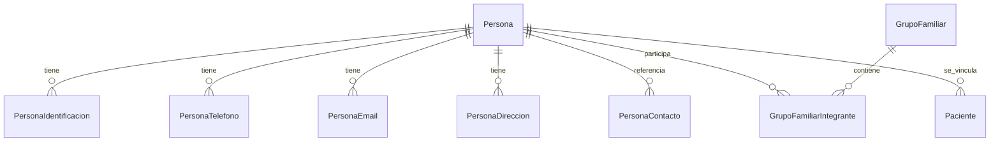

# Admisión — Modelo de datos para implementación

**Versión:** 0.1.0 (propuesta, pendiente de validación)  
**Fecha:** 2026-10-27  
**Destino:** agente de desarrollo  
**Motor de referencia:** Microsoft SQL Server  
**Base de datos de ejemplo:** `APS`  
**Esquema propuesto:** `Admision`

> **Advertencia de vigencia:** este documento fue preparado para SQL Server y es un modelo candidato anterior. La arquitectura acordada ahora es PostgreSQL con TypeORM; no usar este documento como esquema físico vigente ni generar migraciones desde él. La estructura funcional actual está en [ADMISION_ESTRUCTURA_DATOS.md](./ADMISION_ESTRUCTURA_DATOS.md), y sus decisiones se registran en [ADMISION_REQUISITOS_FUNCIONALES.md](./ADMISION_REQUISITOS_FUNCIONALES.md).

> **Estado de aprobación:** este documento especifica un **modelo candidato**, no una orden para ejecutar migraciones en producción. El esquema `Admision`, los campos, las cardinalidades y los catálogos deben ser validados antes de implementar. No inventar decisiones faltantes.

## 1. Alcance y principios

Admisión es un módulo transversal a APS, Teletón, clínicas y hospitales. Su responsabilidad inicial es gestionar identidad, identificaciones, teléfonos, correos, direcciones, contactos, grupos familiares y la vinculación de una `Persona` con un registro `Paciente`.

- Utilizar **`Persona`** y **`Paciente`** como nombres de dominio. No crear `PersonaNatural` ni `PersonaJuridica`.
- No crear entidades de Proveedores ni de otros módulos por anticipado.
- `Persona` es la identidad del individuo; `Paciente` es su participación en un contexto asistencial.
- Una `Persona` puede existir sin ser `Paciente` y potencialmente tener más de un registro de paciente en contextos institucionales diferentes.
- No convertir Admisión en un formulario REM. Los indicadores REM deben derivarse de datos de origen válidos y de hechos asistenciales cuando corresponda.
- FHIR es referencia semántica y de interoperabilidad; **no** exige reproducir literalmente su estructura en SQL Server.
- La gestión de consentimiento, autorización, auditoría y retención debe respetar la normativa chilena aplicable; no asumir que la supresión de una ficha clínica está permitida.

## 2. Convención SQL Server: `Admision` es un SCHEMA

En `APS`, `Admision.Persona` significa **esquema `Admision` + tabla `Persona`**, no una base de datos independiente.

```sql
-- Solo ejecutar después de aprobar la convención de esquemas.
USE [APS];
GO
IF SCHEMA_ID(N'Admision') IS NULL
    EXEC(N'CREATE SCHEMA Admision');
GO
```

Estructura conceptual:

```text
APS (base de datos)
├── Admision (esquema)
│   ├── Persona
│   ├── PersonaIdentificacion
│   ├── PersonaTelefono
│   ├── PersonaEmail
│   ├── PersonaDireccion
│   ├── PersonaContacto
│   ├── GrupoFamiliar
│   ├── GrupoFamiliarIntegrante
│   └── Paciente
└── dbo (esquema predeterminado)
```

**Decisión pendiente:** confirmar el uso de `Admision` como esquema frente a la alternativa `dbo`. No crear el esquema sin autorización.

## 3. Inventario de tablas

| Tabla | Propósito | Relación principal |
|---|---|---|
| `Admision.Persona` | Identidad y demografía | Raíz de identidad |
| `Admision.PersonaIdentificacion` | RUT, pasaporte y otros identificadores | N:1 con Persona |
| `Admision.PersonaTelefono` | Múltiples teléfonos | N:1 con Persona |
| `Admision.PersonaEmail` | Múltiples correos | N:1 con Persona |
| `Admision.PersonaDireccion` | Direcciones y vigencia | N:1 con Persona |
| `Admision.PersonaContacto` | Vínculos de contacto/emergencia | N:1 con Persona, vínculo opcional a otra Persona |
| `Admision.GrupoFamiliar` | Agrupación familiar u hogar | Raíz de grupo |
| `Admision.GrupoFamiliarIntegrante` | Pertenencia temporal | N:1 con GrupoFamiliar y Persona |
| `Admision.Paciente` | Identidad asistencial | N:1 con Persona; contexto institucional por definir |

**Nota:** los catálogos y las referencias institucionales aún no están diseñados; las columnas `...Id` de catálogo son referencias conceptuales, no claves foráneas implementables hasta definir tablas destino.

## 4. Diccionario de datos

**Convenciones:** `PK` = clave primaria; `FK` = clave foránea; `NULL` = opcional; `NOT NULL` = requerido; `IDENTITY` = autonumérico. Los tipos y longitudes son propuestas iniciales.

### 4.1 `Admision.Persona`

| Campo | Tipo SQL Server | Restricción / significado |
|---|---|---|
| `Id` | `BIGINT IDENTITY(1,1)` | PK |
| `PrimerNombre` | `NVARCHAR(100)` | NOT NULL; revisar excepciones documentales |
| `SegundoNombre` | `NVARCHAR(100)` | NULL |
| `ApellidoPaterno` | `NVARCHAR(100)` | NOT NULL propuesto; revisar nombres internacionales |
| `ApellidoMaterno` | `NVARCHAR(100)` | NULL |
| `FechaNacimiento` | `DATE` | NULL |
| `SexoRegistralId` | `INT` | NULL; catálogo por definir |
| `GeneroId` | `INT` | NULL; catálogo por definir; dato sensible según contexto |
| `NacionalidadId` | `INT` | NULL; catálogo por definir |
| `PaisNacimientoId` | `INT` | NULL; catálogo por definir |
| `FechaDefuncion` | `DATE` | NULL |
| `EstadoCivilId` | `INT` | NULL; catálogo por definir |
| `FechaCreacion` | `DATETIME2(3)` | NOT NULL; valor por defecto UTC |
| `FechaActualizacion` | `DATETIME2(3)` | NULL; UTC |

**Pendiente:** definir soporte de nombres preferidos/sociales, múltiples nombres, sexo usado para reportes y atributos de caracterización sensibles sin equipararlos entre sí.

### 4.2 `Admision.PersonaIdentificacion`

| Campo | Tipo | Restricción / significado |
|---|---|---|
| `Id` | `BIGINT IDENTITY(1,1)` | PK |
| `PersonaId` | `BIGINT` | NOT NULL; FK a Persona |
| `TipoIdentificacionId` | `INT` | NOT NULL; catálogo por definir |
| `Numero` | `NVARCHAR(50)` | NOT NULL; conservar ceros y caracteres válidos |
| `PaisEmisorId` | `INT` | NULL; catálogo por definir |
| `FechaEmision` | `DATE` | NULL |
| `FechaVencimiento` | `DATE` | NULL |
| `EsPrincipal` | `BIT` | NOT NULL; default 0 |
| `Verificado` | `BIT` | NOT NULL; default 0 |
| `FechaVerificacion` | `DATETIME2(3)` | NULL; UTC |

**Reglas:** nunca usar RUT como PK de Persona; normalizar y validar por tipo de documento; definir unicidad según tipo/emisor/número y manejo de documentos provisionales antes de crear índice único.

### 4.3 `Admision.PersonaTelefono`

| Campo | Tipo | Restricción / significado |
|---|---|---|
| `Id` | `BIGINT IDENTITY(1,1)` | PK |
| `PersonaId` | `BIGINT` | NOT NULL; FK a Persona |
| `Numero` | `NVARCHAR(30)` | NOT NULL |
| `TipoTelefonoId` | `INT` | NOT NULL; catálogo por definir |
| `CodigoPais` | `NVARCHAR(8)` | NULL; prefijo internacional |
| `EsPrincipal` | `BIT` | NOT NULL; default 0 |
| `Verificado` | `BIT` | NOT NULL; default 0 |
| `FechaVerificacion` | `DATETIME2(3)` | NULL; UTC |
| `Vigente` | `BIT` | NOT NULL; default 1 |

**Reglas:** permitir varios números; definir formato canónico internacional y restricción de un principal vigente por persona cuando se apruebe.

### 4.4 `Admision.PersonaEmail`

| Campo | Tipo | Restricción / significado |
|---|---|---|
| `Id` | `BIGINT IDENTITY(1,1)` | PK |
| `PersonaId` | `BIGINT` | NOT NULL; FK a Persona |
| `Email` | `NVARCHAR(254)` | NOT NULL |
| `TipoEmailId` | `INT` | NOT NULL; catálogo por definir |
| `EsPrincipal` | `BIT` | NOT NULL; default 0 |
| `Verificado` | `BIT` | NOT NULL; default 0 |
| `FechaVerificacion` | `DATETIME2(3)` | NULL; UTC |
| `Vigente` | `BIT` | NOT NULL; default 1 |

**Reglas:** permitir múltiples correos; normalización cuidadosa; no asumir que un email identifica de forma única a una persona.

### 4.5 `Admision.PersonaDireccion`

| Campo | Tipo | Restricción / significado |
|---|---|---|
| `Id` | `BIGINT IDENTITY(1,1)` | PK |
| `PersonaId` | `BIGINT` | NOT NULL; FK a Persona |
| `TipoDireccionId` | `INT` | NOT NULL; catálogo por definir |
| `Calle` | `NVARCHAR(200)` | NULL; dirección no estructurada por definir |
| `Numero` | `NVARCHAR(30)` | NULL |
| `Departamento` | `NVARCHAR(50)` | NULL |
| `Block` | `NVARCHAR(50)` | NULL |
| `Referencia` | `NVARCHAR(300)` | NULL |
| `ComunaId` | `INT` | NULL; catálogo territorial por definir |
| `CodigoPostal` | `NVARCHAR(15)` | NULL |
| `Latitud` | `DECIMAL(9,6)` | NULL; dato de ubicación sensible |
| `Longitud` | `DECIMAL(9,6)` | NULL; dato de ubicación sensible |
| `EsPrincipal` | `BIT` | NOT NULL; default 0 |
| `FechaInicio` | `DATE` | NULL |
| `FechaTermino` | `DATE` | NULL |

**Reglas:** región y provincia pueden derivarse de comuna si el catálogo lo permite; admitir direcciones incompletas; validar fechas de vigencia; no geocodificar automáticamente sin fundamento y autorización.

### 4.6 `Admision.PersonaContacto`

| Campo | Tipo | Restricción / significado |
|---|---|---|
| `Id` | `BIGINT IDENTITY(1,1)` | PK |
| `PersonaId` | `BIGINT` | NOT NULL; FK a Persona principal |
| `ContactoPersonaId` | `BIGINT` | NULL; FK a Persona relacionada si está registrada |
| `NombreExterno` | `NVARCHAR(200)` | NULL; contacto aún no registrado |
| `RelacionId` | `INT` | NULL; catálogo por definir |
| `EsEmergencia` | `BIT` | NOT NULL; default 0 |
| `EsPrincipal` | `BIT` | NOT NULL; default 0 |
| `FechaInicio` | `DATE` | NULL |
| `FechaTermino` | `DATE` | NULL |
| `Observacion` | `NVARCHAR(500)` | NULL; minimizar texto libre |

**Reglas:** exigir al menos `ContactoPersonaId` o `NombreExterno` una vez acordada la regla; impedir autorrelación cuando no proceda; contacto de emergencia **no equivale** a tutor legal ni a autorización de acceso. **Pendiente de diseño:** teléfono/email de contacto externo; no asignarlos a la Persona principal ni inventar columnas sin aprobación.

### 4.7 `Admision.GrupoFamiliar`

| Campo | Tipo | Restricción / significado |
|---|---|---|
| `Id` | `BIGINT IDENTITY(1,1)` | PK |
| `Codigo` | `NVARCHAR(50)` | NULL; código institucional |
| `TipoGrupoId` | `INT` | NOT NULL; catálogo por definir |
| `Nombre` | `NVARCHAR(200)` | NULL |
| `FechaConstitucion` | `DATE` | NULL |
| `FechaTermino` | `DATE` | NULL |
| `Vigente` | `BIT` | NOT NULL; default 1 |
| `FechaCreacion` | `DATETIME2(3)` | NOT NULL; UTC |

**Reglas:** familia, hogar y convivencia no son automáticamente equivalentes; su semántica debe definirse antes de fijar valores de catálogo.

### 4.8 `Admision.GrupoFamiliarIntegrante`

| Campo | Tipo | Restricción / significado |
|---|---|---|
| `Id` | `BIGINT IDENTITY(1,1)` | PK |
| `GrupoFamiliarId` | `BIGINT` | NOT NULL; FK a GrupoFamiliar |
| `PersonaId` | `BIGINT` | NOT NULL; FK a Persona |
| `RolGrupoId` | `INT` | NULL; catálogo por definir |
| `FechaIngreso` | `DATE` | NULL |
| `FechaSalida` | `DATE` | NULL |
| `Vigente` | `BIT` | NOT NULL; default 1 |

**Reglas:** permitir historial y pertenencia a más de un grupo cuando aplique; evitar períodos incompatibles para la misma pertenencia; no inferir tutela ni permisos a partir del rol familiar.

### 4.9 `Admision.Paciente`

| Campo | Tipo | Restricción / significado |
|---|---|---|
| `Id` | `BIGINT IDENTITY(1,1)` | PK |
| `PersonaId` | `BIGINT` | NOT NULL; FK a Persona |
| `InstitucionId` | `BIGINT` | NOT NULL **propuesto**; referencia externa pendiente |
| `NumeroFicha` | `NVARCHAR(50)` | NULL; identificador local |
| `FechaRegistro` | `DATETIME2(3)` | NOT NULL; UTC |
| `EstadoPacienteId` | `INT` | NOT NULL; catálogo por definir |
| `FechaActualizacion` | `DATETIME2(3)` | NULL; UTC |

**Decisión crítica pendiente:** alcance institucional de `Persona` y cardinalidad/unicidad de `Paciente` por institución. **No crear** tabla `Institucion` ni su FK hasta que se diseñe la referencia externa.

## 5. Relaciones



`PersonaContacto.ContactoPersonaId` es una referencia **opcional** adicional a `Persona`. La institución es una dependencia externa todavía no diseñada.

## 6. Catálogos por definir

- `TipoIdentificacion`, `Pais`, `Nacionalidad`.
- `SexoRegistral`, `Genero`, `EstadoCivil`.
- `TipoTelefono`, `TipoEmail`, `TipoDireccion`.
- `Comuna` y jerarquía territorial de Chile.
- `Relacion`, `TipoGrupo`, `RolGrupo`, `EstadoPaciente`.

El agente **no debe inventar IDs numéricos ni equivalencias**. Los catálogos deben tener códigos estables, procedencia y, si son externos, versión/vigencia.

## 7. Revisión REM: matriz de candidatos, no validación oficial

La siguiente matriz **no certifica** que cada dato sea obligatorio en REM 2026. Debe contrastarse con archivos oficiales, glosas y manuales de la versión aplicable.

| Dato | Fuente propuesta | Uso REM potencial | Criterio |
|---|---|---|---|
| Edad / tramo de edad | `Persona.FechaNacimiento` | Desagregación etaria | Calcular según fecha del hecho o corte estadístico; no persistir edad actual |
| Sexo | `Persona.SexoRegistralId` u otra variable definida | Desagregación por sexo | No asumir equivalencia con identidad de género; verificar definición oficial |
| Comuna de residencia | `PersonaDireccion.ComunaId` | Desagregación territorial | Considerar vigencia histórica |
| Nacionalidad | `Persona.NacionalidadId` | Caracterización poblacional | Confirmar formulario y glosa |
| Pueblo originario | **Sin entidad/campo aprobado** | Caracterización específica | Dato sensible; definir catálogo, finalidad y acceso |
| Situación migratoria | **Sin entidad/campo aprobado** | Caracterización específica | No deducir desde nacionalidad |
| Inscripción APS | **Fuera del núcleo Persona** | Población inscrita | Requiere contexto institucional/asistencial |
| Sector territorial APS | **Fuera del núcleo Persona** | Distribución local | No equivale necesariamente al domicilio |
| Población bajo control | **Fuera de Admisión básica** | REM asistencial | Derivar desde programas/episodios pertinentes |
| Grupo familiar | `GrupoFamiliar` / `GrupoFamiliarIntegrante` | Caracterización cuando aplique | Verificar definiciones de hogar/familia |

### Procedimiento obligatorio de trazabilidad REM

Para cada variable confirmada, documentar: año, serie, formulario, sección, fila/columna, código, glosa, fuente oficial, fecha de publicación, vigencia, versión/revisión, transformación y regla de cálculo. Conservar diferencias entre versiones sin sobrescribir definiciones históricas. Si no se dispone del formulario oficial, marcar **pendiente de verificación**; no declarar cumplimiento REM.

## 8. Correspondencia FHIR orientativa

| Dominio | Recurso / tipo FHIR | Precaución |
|---|---|---|
| `Persona` | `Person`, `Patient` según contexto | No equiparar automáticamente identidad global y paciente institucional |
| `PersonaIdentificacion` | `Identifier` | Definir `system`, `value`, `use`, `period` cuando corresponda |
| Nombres | `HumanName` | La estructura SQL inicial es más limitada que FHIR; revisar antes de cerrar |
| `PersonaTelefono` y `PersonaEmail` | `ContactPoint` | `system`, `use`, `rank`, `period` |
| `PersonaDireccion` | `Address` | `use`, `type`, `period`, codificación territorial |
| `PersonaContacto` | `RelatedPerson` o `Patient.contact` según semántica | Contacto no implica autorización |
| `GrupoFamiliar` | `Group` como posible intercambio | No sustituye automáticamente la semántica de hogar |
| `Paciente` | `Patient` | Identificadores y contexto institucional |

**Pendiente:** verificar versión internacional FHIR y perfiles vigentes de HL7 Chile antes de comprometer un contrato de interoperabilidad. Referencias de consulta: https://hl7.org/fhir/ y https://hl7chile.cl/guias/ .

## 9. Reglas obligatorias para el agente

1. **No implementar por inferencia.** Antes de escribir DDL o migraciones, confirmar esquema SQL, cardinalidad de Paciente, catálogos y columnas pendientes.
2. **No crear otros módulos.** Sin `PersonaNatural`, `PersonaJuridica`, `Proveedor` ni tablas institucionales improvisadas.
3. **No usar RUT como PK** ni suponer que todas las personas tienen RUT.
4. **Normalización y trazabilidad:** múltiples identificaciones, teléfonos, correos y domicilios; historial de vigencias donde esté aprobado.
5. **Seguridad:** mínimo privilegio, controles por contexto y finalidad, auditoría de lecturas y cambios sensibles; no registrar datos sensibles completos en logs técnicos.
6. **Integridad:** claves foráneas reales solo cuando existan las tablas destino; checks de rangos/fechas; índices en FK; unicidad según reglas aprobadas.
7. **Tiempo:** definir UTC para timestamps técnicos y conservar semántica local para fechas civiles; no convertir `DATE` en timestamp.
8. **REM:** no guardar agregados REM en Persona ni añadir atributos solo por aparecer en un reporte; documentar fuente y transformación.
9. **FHIR:** mapear semánticamente sin acoplar tablas físicas a recursos de intercambio.
10. **No eliminar historial clínico o datos sujetos a retención** mediante borrado físico indiscriminado.
11. **Pruebas:** cubrir duplicados, identificación sin RUT, múltiples contactos, direcciones históricas, grupo familiar temporal, datos incompletos, acceso no autorizado y fechas de corte.
12. **Entregables posteriores a la aprobación:** migraciones versionadas, diccionario definitivo, diagrama ER actualizado, validaciones, pruebas automatizadas y notas de cambios.

## 10. Decisiones abiertas para validación del arquitecto

| ID | Decisión | Estado |
|---|---|---|
| ADM-D01 | ¿Se utilizará `Admision` como esquema SQL Server? | Pendiente |
| ADM-D02 | ¿`Persona` es única entre instituciones o aislada por institución? | Pendiente |
| ADM-D03 | ¿Cuál es la unicidad de `Paciente` por institución? | Pendiente |
| ADM-D04 | ¿Qué catálogos y códigos oficiales se adoptan? | Pendiente |
| ADM-D05 | ¿Cómo registrar teléfono/email de contacto externo? | Pendiente |
| ADM-D06 | ¿Qué campos sensibles de caracterización exige efectivamente REM? | Pendiente de fuentes oficiales |
| ADM-D07 | ¿Se requiere nombre preferido y representación de nombres no chilenos? | Pendiente |
| ADM-D08 | ¿Cuáles son las reglas de auditoría, acceso, conservación y resolución de duplicados? | Pendiente de detalle |

---

**Instrucción final:** este documento es una **especificación de trabajo**, no un mandato para crear tablas inmediatamente. El agente debe presentar los cambios propuestos, señalar supuestos y esperar validación de decisiones abiertas antes de generar migraciones definitivas.
